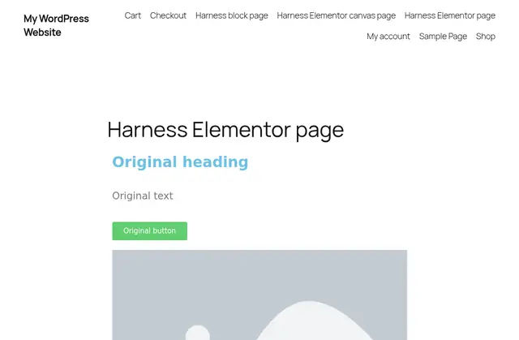
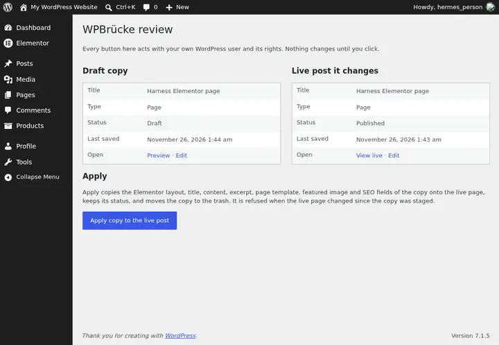
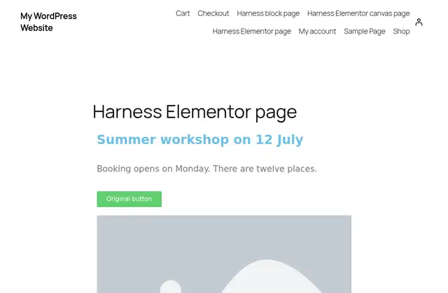

# WPBrücke · for WordPress

WPBrücke lets Hermes run one WordPress site or many. Each WordPress site needs a dedicated user for
Hermes. Its role decides what Hermes can do: read, write drafts, or publish. WPBrücke refuses a user
with wider rights than the level you confirmed.

Hermes writes blog posts and page changes, proves every change in a real browser at three screen
widths, checks SEO, and puts each result on a review desk. It sends a newsletter only on a site whose
admin switched sending on in FluentCRM, and only after you approve a card for that send.

It works on plain WordPress over the core REST API and an application password. No paid plugin or
licence is needed. An optional companion WordPress plugin (the WPBrücke connector) adds a read-only
role, a drafts-with-images role, draft screenshots, SEO fields and a review screen. Theme and page
builder depth ships as optional packs: the GeneratePress pack (GeneratePress and GenerateBlocks from
wordpress.org) and the Elementor pack (texts, links and images on Elementor pages). Two plugin packs
work through the plugin's own abilities and the connector: the WooCommerce pack (draft and live
products) and the FluentCRM pack (newsletter drafts, previews and test emails).

## Who it is for

- **One person, one site** (the default view): blog drafts, what waits for your review, SEO without
  an SEO plugin, publishing in WordPress or with one click.
- **A studio or freelancer with many client sites**: one fleet page, a review desk across sites, a
  build run from client brief to handoff (GeneratePress pack), watchers for updates and outages.

## Things to ask Hermes

Ask in a chat. Hermes picks the tool, and the WordPress role of its user sets the limit.

- "Run wp_doctor for my site." Hermes names the WordPress user behind the password, its level, the
  connector version, the packs and what stays dark and why.
- "Write a blog draft about our summer workshop in the site's tone, and prove it." A draft, its
  screenshots at three widths with the proof's checks, and an item on the review desk.
- "On the Elementor page Workshops, change the heading to 'Summer workshop on 12 July' and the text
  below it to 'Booking opens on Monday. There are twelve places.' Show me the proof." With the
  Elementor pack on, Hermes stages a copy of the page with both edits and proves the copy. The live
  page stays as it is.

  

- "Apply it." At the Publish level Hermes puts the copy on the live page. Below that level you open
  the review screen from the desk and click **Apply copy to the live post** yourself:

  

  The live page then shows the new heading and text to every visitor, without a cache clear:

  

- "What happened with the Workshops page?" Hermes reads the write log and answers with each write
  WPBrücke did or refused there: when, what, by whom and the result.
- "Check the SEO of my latest post and stage the fixes." The post check, with each fix staged as a
  draft copy for your review.
- "Add a draft product 'Linen apron' at 24.90 with a short description, and prove it." With the
  WooCommerce pack on, a draft product whose description uses the site's colours and heading font, its
  product page at three widths through the signed preview link, and a line in the write log.
- "Draft a newsletter about the summer workshop for the list Customers, preview it and send me a test
  copy." With the FluentCRM pack on, a draft campaign in the site's colours and fonts, FluentCRM's own
  preview at 600 and 390 px, and one test email to the address the site's admin saved.

## Install and update

Needs Hermes 0.23.0 or newer.

```bash
hermes plugins install https://github.com/studioluftbruecke/hermes-wpbruecke --enable
```

Hermes Desktop loads the Desktop half (`desktop/plugin.js`) from the computer it runs on, never
from a Hermes on a server. With Hermes on a server, install and update the plugin in both places, on
the same version. With Hermes and Desktop on one computer, one install covers both.

| Where | Install | Update |
| --- | --- | --- |
| Server: tools, routes | `hermes -p <profile> plugins install https://github.com/studioluftbruecke/hermes-wpbruecke --enable` | `hermes -p <profile> plugins update wpbruecke` |
| Desktop computer: Desktop half | `hermes plugins install https://github.com/studioluftbruecke/hermes-wpbruecke` | `hermes plugins update wpbruecke` |

- After either step on the Desktop computer: Capabilities → Plugins → Rescan. A new install's
  Desktop half arrives switched off; switch it on there.
- No Hermes on the Desktop computer: Capabilities → Plugins → Install from Git with the URL; to
  update, the same with Advanced → Force reinstall. Desktop's Update button updates the server only.
- After an update on the server, Desktop chats and the plugin's routes keep the old code: in
  Capabilities → Plugins, switch **Agent in <profile>** off and on, then start a new chat.
- Same version in both places? Compare the Version column of `hermes plugins list` on the Desktop
  computer and `hermes -p <profile> plugins list` on the server, or run
  `git -C ~/.hermes/profiles/<profile>/plugins/wpbruecke log -1 --oneline` on each
  (`~/.hermes/plugins/wpbruecke` for the default profile).
- The settings page shows the update line when Desktop talks to a Hermes on another computer.
- The sidebar switch and position on the WPBrücke settings page are kept per Desktop, so a second
  computer starts with the defaults.

**The WordPress connector** has the same version as the plugin (0.5.0). Where a site's connector
reads `not installed` or `v<x> · older than needed`, the WPBrücke page offers two buttons in
**Settings → Connections**:

1. **Download connector**: Desktop saves `wpbruecke-connector-0.5.0.zip` to your computer.
2. **Install in WordPress**: opens the site's `wp-admin/plugin-install.php?tab=upload`. Choose the
   zip, **Install Now**, **Activate**. Over an older connector, WordPress asks to **Replace current
   with uploaded**.

The site card and the fleet card show **Install in WordPress** too. A Desktop that cannot save files
from Hermes (an older Desktop, or a profile whose workspace is an SSH machine) shows the command
instead: run `hermes wpbruecke connector-zip --out PATH` on the Hermes computer, then upload the zip
in WordPress.

## Setup: connect a site

The WPBrücke page in Hermes Desktop walks you through this (**Connect a site**). It names the first
free group, Site 1 to Site 16.

1. **In WordPress → Users → Add New User**, create a user for Hermes named `hermes`, with the role
   for the level you want (table below). Use a user of its own, never your own login: the role is
   the limit, and a user of its own can be changed or deleted without touching yours.
2. **Signed in as that user**: wp-admin → Users → Profile → **Application Passwords** → name it
   `Hermes` → **Add New Application Password**, and copy it.
3. **In Hermes Desktop**: on the WPBrücke page, **Open the settings**, then fill **Site N ·
   address**, **Site N · WordPress user** and **Site N · application password** and **Save**.
4. **Back on the WPBrücke page** the connection is checked. It shows what WordPress lets this user
   do ("Connected as hermes at example.com. WordPress lets this user write drafts with images.
   Hermes will do exactly that."). Click **Confirm**. Apart from the connection check, nothing uses
   the password before you confirm.

When the check fails, the page names the cause and the next step: a wrong user or password, a web
server that drops the login header (the `.htaccess` line to add), application passwords turned
off, Plain permalinks, an address that redirects, an administrator user.

A public site without a password is added on the WPBrücke page with its address only, or by asking
Hermes (`wp_sites action=add`). Hermes then reads only what the public sees.

**Remove a site:** on the WPBrücke page, **Remove** revokes the application password in WordPress
(optional), empties Site N's address and user, and deletes the site file. If emptying the fields
fails, the page asks you to empty Site N · address and Site N · WordPress user in the settings.

Optional extras:

- `hermes wpbruecke doctor` (or ask "run wp_doctor") names the user behind each key, its level and
  which features stay dark and why.
- The connector: **Download connector** on the WPBrücke page (Install and update above), or
  `hermes wpbruecke connector-zip --out ~/Downloads`, then wp-admin → Plugins → Add New → **Upload
  Plugin** → **Activate**. Needed for the Read level, the drafter role, the Elementor pack (0.4.0 or
  newer), the shop roles and the FluentCRM screen (0.5.0 or newer) and naming Beaver Builder, Bricks,
  Oxygen and Breakdance pages.
- The watcher: `hermes wpbruecke watch-setup` prints a script and the `hermes cron create` line for a
  no-agent job that reports only changes.

## Access levels

| Level | WordPress role of the Hermes user | What Hermes can do |
| --- | --- | --- |
| Read | **WPBrücke reader** (connector 0.2.1 or newer) | Read posts, pages and drafts, run proof and SEO checks. Every write is refused by WordPress itself, over REST and XML-RPC; the role stores only read rights. Give the user this role alone: a reader with a second role is refused |
| Drafts | **Contributor** (no images), **WPBrücke drafter** (with images, connector) or **WPBrücke shop drafter** (with images and draft products, connector 0.5.0) | Write drafts, staged copies of live posts and SEO fields. Publishing opens WordPress, where your own login publishes |
| Publish | **Author** (own posts), **Editor** (all posts and pages) or **WPBrücke shop publisher** (own posts and products, connector 0.5.0) | All of the above, plus publish, schedule and apply staged copies, without asking |
| Refused | **Administrator**, or any user who can manage options, users, plugins or themes | Nothing. Use a user with one of the roles above |

A Subscriber can only read what the public sees.

- **You confirm the level once.** WPBrücke reads the user's role again before acting (at most 60 s
  old for reads, 5 s for writes) and on every watcher tick. More rights than you confirmed stop the
  site until you confirm again on the page; fewer rights lower the level on their own.
- **Within the level there is no approval card.** At the Publish level Hermes publishes when you ask
  it to, and the desk's Publish, Schedule and Apply buttons act directly.
- **Scheduled runs write drafts.** A recurring-draft automation you wrote in a site file writes a
  draft on that one site. It publishes only when the automation says `publish: true` and the level
  is Publish, and then only the post that same run created. Every other unattended write (cron, webhooks, single-query runs) is refused before any
  request.

**The honest limit.** Only the WordPress role holds against everything. Hermes stores the
application password in the profile's `.env`, so anything with shell access on the Hermes host (an
agent's terminal tool included) can read it and use it with the full rights of the role. WPBrücke's
own checks stop Hermes' tools from going past the confirmed level; they cannot stop a shell. Pick the
narrowest role that does the job.

## Update from 0.1.0

Your passwords stay where they are (`WPBRUECKE_KEY1` … `WPBRUECKE_KEY12` are Site 1 to Site 12's
passwords now). On the first load, each 0.1.0 site file with a key fills its group's address and
user. Its level is not carried over: the WPBrücke page checks the connection and asks you to
confirm it, and apart from the connection check nothing uses the password until you do. The 0.1.0 settings `publishing`,
"never publish, never send" and `agent_writes` are gone; the role replaces them. An administrator key
from 0.1.0 is refused: create a user with one of the roles above. Update the connector to 0.2.1 for
the Read level. Connector 0.2.0 is not enough: its reader role stored edit rights in WordPress, so a
reader on 0.2.0 is refused until you upload 0.2.1, which removes them.

## Settings

| Setting | Default | What it does |
| --- | --- | --- |
| `site1_url` … `site16_url`, `site1_user` … `site16_user` | empty | Site N's address and the dedicated WordPress user for Hermes (login or email); an empty address means the group is free |
| `site1_password` … `site16_password` (secret, `WPBRUECKE_KEY1` … `WPBRUECKE_KEY16`) | empty | Site N's application password. WPBrücke sends it only to the address it was last checked against, over https |
| `chromium_path` | empty (Hermes' Chromium) | Another Chromium for proofs |
| `digest` | on | The watcher also reports updates, slow sites and items waiting; off: outages only |
| `psi_key` (secret, `WPBRUECKE_PSI_KEY`) | empty | PageSpeed Insights key; without it speed is measured locally and labelled "local, not Google" |
| `gsc_key` (secret, `WPBRUECKE_GSC_KEY`) | empty | Search Console service account JSON (or its base64); see below |

Each site has a readable YAML file (`sites/<id>.yaml` in the plugin's data folder): its address,
login and group (from the settings), the confirmed access level, proof widths, a short memory (tone,
languages, pages not to touch), recurring-draft automations, its packs, design overrides, an optional
Search Console property and an optional Coolify app for the Coolifybrücke link. Every save keeps a
version with author and diff. Hermes cannot change a connected site's address, user, group or access
level; changes to a connect IP, proof hosts, automations or packs ask first and are refused
unattended.

The WPBrücke page reads its passwords fresh on each request: in the profile's plugin host process it
asks Hermes' secret scope builder (`agent.secret_scope.build_profile_secret_scope`, not a documented
plugin API) for the `WPBRUECKE_*` keys, at most every two seconds, so a password saved in the settings
shows on the page without a restart.

**Passwords from 1Password or Bitwarden.** Hermes can load secrets from 1Password or Bitwarden Secrets
Manager instead of the profile's `.env` (`hermes secrets onepassword` and `hermes secrets bitwarden`,
see https://hermes-agent.nousresearch.com/docs/user-guide/secrets/). WPBrücke reads every password
through Hermes' `get_secret`, so a `WPBRUECKE_KEY1` that comes from either source works like one
saved in the settings. WPBrücke itself talks to neither service.

## What it does

| Surface | What it does |
| --- | --- |
| **WPBrücke page** (Desktop) | One site: its desk, SEO, health and settings. Many sites: the fleet, then each site. Sidebar row "WPBrücke · N" with the items waiting for you (show switch and position on the settings page), three palette commands |
| **Review desk** | Every draft and staged change with screenshots at 1440, 768 and 390 px, the proof's verdicts and SEO notes. Mark reviewed, ask for changes (a prefilled chat); at the Publish level Publish, Schedule and Apply, below it open WordPress |
| **Proof** | A headless browser renders the page: console errors, horizontal overflow, broken same-site links, image alt text, contrast, local load time, the pixel difference against the live page. Each check answers match, differs or not proven with the reason |
| **SEO** | Post check (title, description, headings, internal links, alt text, slug, readability in English and German), site check (indexing, sitemap, robots, home description, canonical, mobile, speed), fixes staged as drafts |
| **Staged changes** | A change to a published post is a new draft copy that points to its source. The live post stays untouched until the copy is applied: by Hermes or the desk at the Publish level, otherwise on the connector's review screen |
| **In chat** | `@wp:<site>/<post id>` adds a post to your message, and a draft card shows what Hermes wrote |
| **Watchers** | `hermes wpbruecke tick` reads every site and prints only what changed: down, broken, back, slow, new update offers, items waiting. A clean tick prints nothing. See Watcher alerts below |
| **Recurring drafts** | An automation you write in a site file ("every Monday a draft from my notes") may write drafts on that one site from a cron job named `wpbruecke:<site>:<automation id>`, and publish only with `publish: true` at the Publish level, and only the post that run created; every other unattended write is refused |
| **Build run** (GeneratePress pack) | Brief, brand, sitemap, pages as GenerateBlocks (or core block) drafts, header and footer, proof, client handoff. Each step names who acts; every gate is your click |
| **Builder guard** | Names the page builder of each post and keeps the body of a builder page unchanged unless its pack is on. See Page builders and packs below |
| **Elementor pack** | Texts, links and images of existing Elementor widgets, through a staged copy, a proof and an apply. See Page builders and packs below |
| **WooCommerce pack** | Lists products, writes draft products in the site's design, and at the Publish level creates and changes live products with a read-back. See WooCommerce products below |
| **FluentCRM pack** | Draft campaigns in the site's design, FluentCRM's preview as the proof, test emails to one saved address, and a schedule only where the site's admin allows it, with a card each time. See FluentCRM newsletters below |
| **Write log** | One line per write WPBrücke does or refuses, per site. Hermes reads it to answer "what happened with X"; the site page shows it in a closed **Activity** section. See The write log below |
| **Connector** (WordPress plugin) | Reader role (read-only, enforced by WordPress), drafter role, two shop roles with a publish guard on WooCommerce's product save, the FluentCRM screen and its routes, signed preview links so drafts can be screenshotted, the SEO description printed in the page head, update counts, the page builder of each post, Elementor routes (read, stage, save, apply), the review screen where your own click publishes, schedules or applies a staged copy |
| **Tools** | `wp_doctor`, `wp_sites`, `wp_content`, `wp_draft`, `wp_desk`, `wp_proof`, `wp_seo`, `wp_build`, `wp_pack` (plugin packs: list, describe and run the ops a pack declares, through the plugin's own abilities on WordPress 6.9 or newer or a connector route; only on a site whose site file switches the pack on, inside the site's level, and with a card every time for ops that ask for one) |

## Watcher alerts

`hermes wpbruecke watch-setup` prints the `hermes cron create` line for the watcher. Each tick prints
only what changed since the last one:

- **Down.** The site gave no answer at all. One line, again after 6 hours, then "is back".
- **Broken.** The public home page answers with a 5xx status or WordPress' error page. One line
  ("is broken since 14:02 UTC: the home page answers HTTP 500"), again after 6 hours, then "is
  back" when it answers normally.
- **Updating.** WordPress' maintenance page (503 with Retry-After) while an update runs. The first
  tick that sees it prints nothing. When the next tick still sees it, it reports the site as broken:
  an update may have stopped halfway.
- **Update offers.** Each offer is tracked by its key (WordPress, one plugin, one theme). A line
  names an offer only when its version was not announced before, so the same update never arrives
  twice. The first tick of a site (and the first 0.3.0 tick on a site an older version watched)
  prints one summary of everything pending. A failed read of api.wordpress.org prints nothing and
  keeps what was announced.
- **Slow, waiting, stopped.** REST much slower than usual, more items waiting on the review desk, a
  site stopped because its user's rights changed.

A site's down, broken and back lines come before its update lines. `wp_doctor` shows the same
health ("health: ok (the home page answers HTTP 200)"), and the WPBrücke page shows **Broken** or
**Updating** on the site's card. With `digest` off, only the down, broken, back and stopped lines
remain.

**Plugin and theme updates.** WordPress shows plugin and theme update offers only to users with the
`update_plugins` capability. Only administrators hold it, and WPBrücke refuses administrators. So
with the roles WPBrücke accepts, the watcher sees WordPress core updates only (from the version the
site's public pages name and api.wordpress.org). To get plugin and theme offers too, give the Hermes user the
`update_plugins` capability with a role editor plugin (for example Members or User Role Editor).
That capability also lets the user update plugins in wp-admin, so give it only if you accept that.
Any change to the user's rights stops the site until you confirm again on the WPBrücke page.

## Page builders and packs

`wp_content get` names the page builder of each post: the block editor, the classic editor,
Elementor, Divi, WPBakery, Beaver Builder, Bricks, Oxygen or Breakdance. The connector names it from
the post's builder meta. Without the connector, WPBrücke reads Elementor's REST meta and the markers
Divi and WPBakery leave in the body. Beaver Builder, Bricks, Oxygen and Breakdance are named only
through the connector: without it, on a site that runs one of them, every page without block
markup counts as an unknown builder, and its body is read-only.

**A builder page keeps its body.** Changing the body of a builder page would not show or would break
its layout, so `wp_draft` refuses `update`, `stage` and `apply` with a new body before it sends
anything. Its title, excerpt, SEO fields and featured image still work. Editing a builder's body
needs a pack for that builder. Elementor has one (below); for every other builder the body stays
read-only. The WPBrücke page shows such a builder on a site as **Divi · no pack** (and so on).

**The Elementor pack.** It changes texts, links and images of existing heading, text editor, button,
image, icon list and call-to-action widgets, through a staged copy. It never adds, removes or moves
an element and never creates an Elementor page. Every other widget and every V4 atomic element
(Elementor 4's new elements) stays read-only. It is tested on Elementor 4.4.2. On another Elementor
release every Elementor page body stays read-only, and Hermes names the tested range; a later
WPBrücke release widens it once a test run on the new Elementor is green. Call-to-action is an
Elementor Pro widget and is tested on recorded pages only.

To use it, the site needs Elementor and the connector 0.4.0 or newer. Switch the pack on with
`packs: {elementor: true}` in the site file, or by asking Hermes (you get a card). Then:

1. `wp_content get` reads the page as Elementor's element tree and marks what may change.
2. Hermes stages a copy with its edits. The connector copies the page with Elementor's own copy of
   its data (page template and featured image included) and saves through Elementor's own save, so
   revisions and Elementor's CSS stay right. The live page does not change.
3. `wp_proof` screenshots the copy through a signed preview link, with its own CSS and template.
4. At the Publish level Hermes applies the copy; below it, you click **Apply copy to the live post** on the review
   screen. Either way the live page gets the layout, Elementor's caches for it are cleared, and the
   copy goes to the trash.

When Hermes cannot make an Elementor edit, it says why:

- **Someone edited the live page after the copy was staged.** Apply is refused, so nobody's change is
  lost. Stage the change again from the live page.
- **The Hermes user has the drafter role.** It edits only its own Elementor posts, never pages. An
  Editor's password stages page changes.
- **The Hermes user lacks the `unfiltered_html` right** (an Editor on a multisite network). Where
  WordPress would strip HTML from parts of the page the edit does not touch, the edit is refused. A
  user with that right makes it.
- **The setting comes from a dynamic tag, the element is outside the scope, or the edit would add or
  remove an element.** Refused; you change it in Elementor.

**Blocks of other plugins stay.** A change that would remove blocks of a plugin WPBrücke does not
know (Kadence, Spectra, Otter, ...) is refused with the block names. Hermes either keeps them, or,
after you agree, names them in `drop_blocks`.

**Packs.** A pack teaches WPBrücke one theme, page builder or plugin. 0.5.0 has four: the
GeneratePress pack (build runs as GenerateBlocks drafts, brand colours staged for your click), the
Elementor pack, the WooCommerce pack and the FluentCRM pack. You switch a pack on per site in the site
file (`packs: {generatepress: true}`, `elementor`, `woocommerce` or `fluentcrm`), or by asking Hermes.
The site's Settings tab has a switch for the GeneratePress pack. Only known pack ids are accepted.
When Hermes asks to switch one on, you get a card; a scheduled run cannot. `wp_doctor` lists each pack
per site: detected or not, on or off, and what it still needs.

**Plugin packs run through `wp_pack`.** The WooCommerce and FluentCRM packs each declare a short list of
ops. An op runs one ability of the plugin (WordPress 6.9 or newer has the Abilities API) or one
connector route, and nothing else of the plugin: every other ability it offers is refused before any
request, and `wp_doctor` lists those as "seen, not enabled". An op runs only on a site whose site file
switches its pack on, only inside the site's level, never in a scheduled or one-shot run, and an op
that sends something to people (a FluentCRM schedule) shows you a card every time.

**Design tokens.** `wp_sites get` returns the site's colours, fonts and logo, read live from the
theme: GeneratePress' global colours through the connector, Elementor's global colours and fonts
where the Elementor pack is on, otherwise the theme's global styles. The
site file's `design:` block holds only what you want different. It is merged key by key, and every
key it changed is listed under `overridden`.

## WooCommerce products

**The WooCommerce pack** lists products, writes draft products (name, description, prices, categories,
featured image), and at the Publish level creates and updates live products with a read-back. It never
reads or changes orders or customers and never deletes a product. Those stay yours, in WooCommerce.

It needs WooCommerce, the connector 0.5.0 or newer, and one of the connector's two shop roles for the
Hermes user:

| Role | Level | What Hermes can do with products |
| --- | --- | --- |
| **WPBrücke shop drafter** | Drafts | New draft products and edits to its own draft products. A publish is refused by WPBrücke, and by the connector on WooCommerce's own API too |
| **WPBrücke shop publisher** | Publish | Also creates products and changes live ones (its own), each read back after the write |

WooCommerce's own Shop Manager role is refused, because it can change theme settings and list users.

1. **In WordPress → Users**, click the Hermes user, set **Role** to **WPBrücke shop drafter** (or
   **WPBrücke shop publisher**), **Update User**. The shop roles replace the user's old role, and they
   cover posts too: the shop drafter writes post drafts with images, the shop publisher publishes its
   own posts.
2. **On the WPBrücke page** the site waits for your confirmation, because the user's rights changed.
   It names what WordPress now lets the user do. Click **Confirm again**. (Going from Editor to the
   shop drafter may instead lower the level on its own; then there is nothing to click.)
3. **Switch the pack on.** Ask Hermes "switch on the WooCommerce pack for <site>" and approve the
   card, or set `packs: {woocommerce: true}` in the site file.

Then ask for a draft product. Hermes writes it with `wp_pack`, lays the description out in the site's
colours and heading font, and proves the product page at three widths through the signed preview link.
In the proof, a draft product's page shows no **Add to cart** button: WooCommerce shows it on a draft
only to users who may edit the product, and the proof browser is logged out. At the Drafts level you
publish the product yourself in wp-admin → **Products**.

## FluentCRM newsletters

**The FluentCRM pack** (free FluentCRM and FluentCRM Pro) drafts email campaigns in the site's design,
previews them and sends test copies to the address the site's admin saved. It schedules a campaign only
where the admin switched sending on, after a card every time. It never sends to a single contact, never
pauses, unschedules or deletes a campaign, and never writes contacts, lists, tags or automations.
Tested with FluentCRM 3.3.5 and FluentCRM Pro 3.3.1 on WordPress 7.1.5.

It needs FluentCRM and the connector 0.5.0 or newer. The Hermes user keeps its role (Contributor,
WPBrücke drafter, Author, Editor or a shop role; never an administrator).

1. **In WordPress → Settings → WPBrücke FluentCRM** (an administrator only): pick the Hermes user under
   **Hermes user**, click **Show**. Until you save, the screen says "Not saved for this user yet" and
   Hermes does nothing in FluentCRM.
2. Tick what Hermes may do. **View campaigns** and **Write draft campaigns** are ticked by default.
   - **Send test emails, to the address below**: type your own address under **Test email address**.
     Test copies go only there; an address Hermes names is ignored.
   - **Schedule and send campaigns**: leave it off unless you want Hermes to schedule sends. While it
     is off, FluentCRM itself refuses the Hermes user every send, whatever uses its password.
     Switching it on hands over FluentCRM's whole "Write and send emails" permission; WPBrücke then
     asks with a card before each send, and that card is WPBrücke's check, not WordPress'. Without it
     you send from FluentCRM's campaign editor; the desk item of each campaign links there.
3. Click **Save**. Saving also gives the Hermes user a FluentCRM contact of its own (status
   transactional, in no list), so previews and test emails never show a real customer's name.
4. **Switch the pack on.** Ask Hermes "switch on the FluentCRM pack for <site>" and approve the card,
   or set `packs: {fluentcrm: true}` in the site file. `wp_doctor` then shows a line "FluentCRM
   permissions" with each box on or off.
5. **Fill in your business address** in FluentCRM → **Settings** → **Business Settings**. FluentCRM
   prints it in every email's footer, and an empty one leaves a stray "," there, in previews and test
   emails too.

Deactivating the connector takes back the FluentCRM permissions its screen granted.

## The write log

Every write WPBrücke does or refuses becomes one line in a log per site: the time, the tool and
action, the post's id and its title at that moment, who asked (Hermes, you on the page, an
automation, the connection check) and the result (`ok`, `refused` with its code, or `error`). Ask
Hermes "what happened with <page>" or "did you change <post>": it reads the log through
`wp_doctor action=log` before it answers, and says so when the log has nothing. The log starts with
0.4.0; for older changes Hermes offers the post's revisions.

The log keeps 5 MB or 90 days per site and drops its oldest lines first. A line never holds a body, a
password or a token: every line, and every tool result, passes a scrubber that removes passwords,
application passwords and tokens.

On the WPBrücke page, the site page ends with a closed **Activity** section. Open it to see the last
50 lines, newest first. It reads nothing until you open it and shows no badge or count.

## Your sites, your click

- **The role is the limit.** See Access levels above.
- **Prompt injection.** Post content and comments are data in tool results. A write goes only to
  the site named in the call.
- **"Discourage search engines"** is never changed by Hermes; the SEO check links to the setting.
- **Passwords travel only to their own site.** A password is sent only to the address it was last
  checked against, over https, never across a redirect. When Site N's address changes to another
  host, its old password is not sent anywhere until you paste the new site's password.

## Search Console (optional)

1. https://console.cloud.google.com/iam-admin/serviceaccounts → **Create service account** (no
   roles), then Keys → **Add key → JSON**.
2. https://search.google.com/search-console → your property → Settings → Users and permissions →
   **Add user**: the service account's e-mail, permission **Restricted**.
3. Paste the JSON into **Search Console service account** in the plugin settings, and set
   `gsc_property` in the site file (`sc-domain:example.org` or the URL prefix).
4. A post check of a published post then shows its top search queries of the last 28 days.

## Disclosures

- **Network calls:** to each WordPress site you add (its REST API, with the WooCommerce or FluentCRM
  pack on also that plugin's abilities and REST routes, its pages in the proof browser,
  and with the connector its `wpbruecke/v1` routes); to `api.wordpress.org` for the latest plugin,
  theme and core versions (slugs only); to Google PageSpeed Insights only when you store its key; to
  Google's token endpoint and the Search Console API only when you store a service account. No other
  host.
- **Child processes:** a headless Chromium (Hermes' own, or one you set) renders pages for proofs.
  It gets a minimal environment, a throwaway profile, and may reach only the site's host plus hosts
  you allow per site (`proof.extra_hosts`). One proof runs at a time.
- **Background work:** none inside Hermes. The watcher runs only when you schedule
  `hermes wpbruecke tick` as a Hermes cron job. Proof and SEO jobs started on the page run in the
  plugin's host process and end with their result.
- **Files:** everything is written under the plugin's data folder (site files and their versions,
  the desk, proof screenshots, SEO reports, build runs, caches, and the write log in
  `logs/<site>.jsonl`). Nothing outside it, except the connector zip at the path you name.
- **Credentials:** application passwords per site, an optional PageSpeed key and an optional Search
  Console service account, stored by Hermes in the profile's `.env` through the plugin settings and
  read at call time. Any secret stored for Hermes on a host can be read by an agent with shell
  access there; only the WordPress role limits what that password can do (Access levels, the
  honest limit).
- **WordPress side:** the connector adds four roles (`wpbruecke_reader`, `wpbruecke_drafter`,
  `wpbruecke_shop_drafter`, `wpbruecke_shop_publisher`), a REST field naming each post's page builder
  (shown only to users who can edit that post), post meta (`_wpbruecke_description`,
  `_wpbruecke_title`, `_wpbruecke_source`), options for its preview secret, a staged GeneratePress
  brand, the shop roles' sync state (`wpbruecke_shop_roles`) and the FluentCRM screen's boxes
  (`wpbruecke_fluentcrm`), the review screen and the FluentCRM screen. Its Elementor routes write
  Elementor's own post meta on draft copies, and its apply route copies it onto a live page for a user
  WordPress lets publish that page. Its shop route saves draft products through WooCommerce, and a
  guard on WooCommerce's product save refuses a publish by a user who may not publish products. A
  save on the FluentCRM screen writes the Hermes user's FluentCRM permissions (FluentCRM's own list,
  and Pro's `_fcrm_has_role` marker) and creates a FluentCRM contact for that user; its three
  FluentCRM routes lend FluentCRM's "Write and send emails" permission for one call each (previews
  and test emails also "Read contacts", to render against that user's own contact) and store
  nothing about the user. Test emails leave through the site's own mail setup. The reader role stores
  only read rights; the connector adds the edit rights that show drafts only while it serves a REST
  read. Deactivating it removes the reader and shop roles (on every site of a network) and takes back
  the FluentCRM permissions its screen granted, so a reader or shop user is left with no rights at
  all; deleting it removes every role and option it added.
- **Telemetry:** none.

## Development

Tests live in `tests/`. Run them with `python -m pytest tests` from the plugin folder, with Hermes'
source on `PYTHONPATH`; `hermes plugins validate` and `hermes plugins doctor` check the install.
`docs/testing.md` says what each kind of test proves, how to run the opt-in WordPress Playground
tests (`WPB_HARNESS=1`), and what no test proves yet.

## License

MIT, see `LICENSE`. The connector WordPress plugin is MIT too (GPL-compatible).
